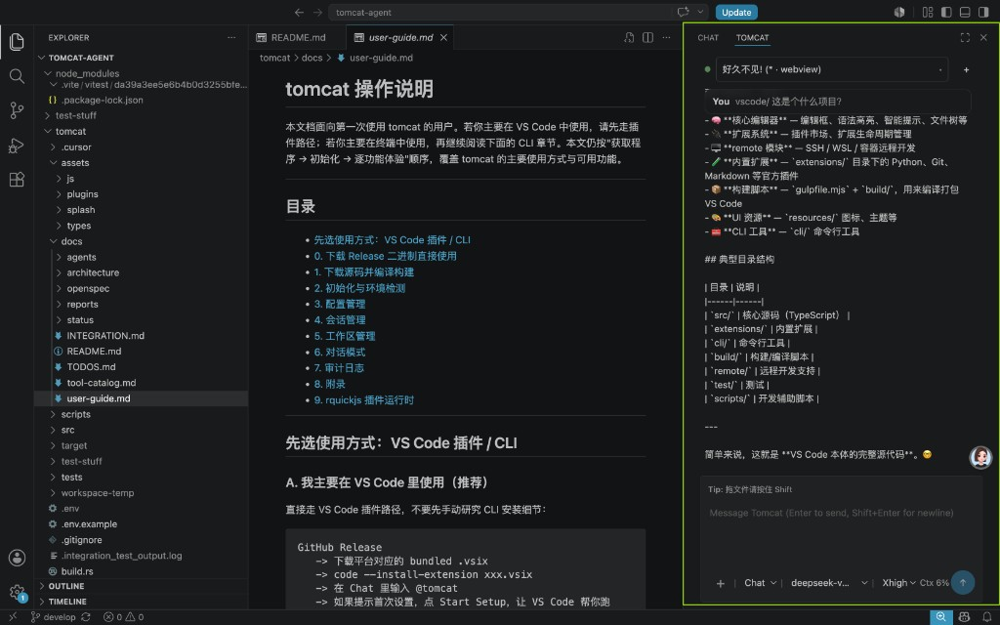

# tomcat

<p align="center">
  <a href="README.md">English</a> |
  <a href="README.zh.md">简体中文</a>
</p>

A lightweight Rust-based AI agent runtime and VS Code extension built as a hands-on project for learning agent development: [`tomcat/`](tomcat/) provides the runtime, CLI, and `tomcat serve --stdio`, while [`tomcat-vscode-ext/`](tomcat-vscode-ext/) provides Tomcat Agent Box inside VS Code.



## Features

- **Tomcat Agent Box**: The main experience is a chat panel in the VS Code Secondary Side Bar, with multi-session switching, `Chat/Plan` modes, model switching, attachments, context-watermark controls, and an in-product **Add Models** settings center; install the bundled `.vsix` and start using it right away.
- **Autonomous agent loop**: A three-layer nested loop (conversation management -> fault-tolerant retry -> think-act) supports Steering / FollowUp / Abort, with automatic context compaction and rate-limit backoff for long conversations.
- **Robust code read/write**: Beyond primitives such as `read`, `write`, `edit`, and `list_dir`, it also offers `hashline_edit` for line-anchored edits; `search_files` supports both system `rg` / `fd` and an in-process fallback implementation while consistently honoring ignore rules.
- **Command execution and background tasks**: `bash` runs behind permission gating; long-running work can continue in the background and be driven across turns with `task_output` / `task_stop` / `task_list` instead of blocking the whole session on one command.
- **Web retrieval**: `web_search` normalizes multiple search backends, and `web_fetch` converts web pages into Markdown while proactively blocking private-network / loopback / credentialed URLs.
- **Plans, todos, and clarification questions**: `create_plan` / `update_plan` / `todos` / `ask_question` let long tasks move from planning to execution to tracking. Clarification questions have no wall-clock deadline: they stay available until you answer or skip them, interrupt the turn, or the host connection is irrecoverably closed.
- **Skills and plugin extensibility**: Skills can be loaded by name; the plugin system uses in-process `rquickjs`, and sensitive capabilities go through `pi.*` host calls so both LLM tools and host extension points can be expanded.
- **Project Commands and Rules**: Markdown commands and always-applied rules from `.agents` / `.cursor`, with grouped slash suggestions, invocation chips, repeatable references and a bounded composer. See [extension usage](tomcat-vscode-ext/README.md#project-prompt-commands-skills-and-rules).
- **Multi-model support and security auditing**: Supports OpenAI Chat Completions, OpenAI Responses, and Anthropic Messages; ships built-in presets for OpenAI / DeepSeek / MiMo / GLM / Kimi / Claude Opus; `models.toml` plus `.env` manage model catalogs and credentials; PermissionGate, shadow-Git checkpoints, JSONL transcripts, and audit logs keep runs controllable and traceable.
- **Terminal CLI**: With no subcommand it enters `chat` by default, and also covers full workflows for `init`, `doctor`, sessions, configuration, workspace management, and auditing.

## Quick Start

Recommended entry points:

- **VS Code extension (recommended)**: Install `tomcat-agent.tomcat-vscode-ext` from the [VS Code Marketplace](https://marketplace.visualstudio.com/items?itemName=tomcat-agent.tomcat-vscode-ext); verify publisher **tomcat-agent**. Platform-specific GitHub VSIX downloads remain available for offline installation. After installing, press `Cmd/Ctrl+Shift+P` and run `Tomcat: Focus Agent Box` to open **Tomcat Agent Box**. You can also open the Secondary Side Bar first and click the Tomcat Agent Box icon. If you see the first-time prompt, click `Start Setup` so VS Code can run `tomcat init` for you. For package selection and installation details, see [`tomcat-vscode-ext/README.md`](tomcat-vscode-ext/README.md).
- **CLI**: See the **[User Guide](tomcat/docs/user-guide.md)** for end-to-end steps and sample output covering prerequisites, builds, `init` / `doctor` / `chat`, sessions and workspace handling, configuration, auditing, and integration tests.

Supported platforms: macOS (Apple Silicon and Intel), Linux x64 (glibc), and Windows x64. On Windows, install [Git for Windows](https://git-scm.com/download/win) first: the `bash` tool runs commands through its Git Bash.

General prerequisites: you need a provider API key that matches the model you plan to use (for example OpenAI-compatible, DeepSeek, MiMo, GLM, Kimi, or Anthropic). Whether you use the VS Code extension or the CLI, you can complete first-run setup with `tomcat init` (or by clicking `Start Setup` in VS Code). Keys are written to `~/.tomcat/assets/.env`, readable only by the current user (`0600` on Unix, a private ACL on Windows), and loaded automatically on startup. Runtime data defaults to `~/.tomcat/`; see [Working Directory and Data Layout](tomcat/docs/architecture/work-dir-and-data-layout.md) for the directory layout.

You only need Rust stable 1.70+ when building from source. The repository's `tomcat/.env` is only for local/CI test fixtures and is not the end-user configuration path.

### Windows developer updates

After first-time `tomcat init` has set up PATH, run `.\scripts\dev-install.cmd` from the repository root in an independent PowerShell/CMD terminal to build and update the installed executable. The [thin entry](scripts/dev-install.cmd) delegates to Cargo; it does not restart a running service. Then use `/restart` in VS Code (stops all tasks), or the existing restart command in the Command Palette. Tomcat Agent tools cannot bypass the self-install guard. See [the Windows workflow and path-selection boundaries](tomcat/docs/user-guide.md#windows-development-environment).

## Project Structure

| Component | Purpose | Primary docs |
| --- | --- | --- |
| [`tomcat/`](tomcat/) | Rust agent runtime, CLI, and `tomcat serve --stdio` | [User Guide](tomcat/docs/user-guide.md), [tomcat/src/README.md](tomcat/src/README.md) |
| [`tomcat-vscode-ext/`](tomcat-vscode-ext/) | VS Code extension and Tomcat Agent Box | [tomcat-vscode-ext/README.md](tomcat-vscode-ext/README.md) |

```text
tomcat/
├── src/
│   ├── api/              # CLI, serve --stdio, config, session, plugin, audit, ...
│   ├── core/             # Agent Loop, LLM, sessions, tools, permissions, checkpoints, plan
│   ├── ext/              # Plugins and extension capabilities
│   └── infra/            # Config, logging, auditing, event bus, errors, platform I/O
└── docs/
    ├── openspec/         # Constitution, architecture index, development and test specs
    ├── agents/           # Role cards, task boards, plan templates
    └── architecture/     # Runtime, working directory, and subsystem design
```

```text
tomcat-vscode-ext/
├── src/                  # Extension host: serve bridge, webview provider, typed protocol
├── gui/                  # Tomcat Agent Box frontend (React + Vite)
└── docs/architecture/    # Extension architecture design
```

For module-level details, see [tomcat/src/README.md](tomcat/src/README.md); for extension installation and usage, see [tomcat-vscode-ext/README.md](tomcat-vscode-ext/README.md).

## Architecture

Bottom-up, one-way dependencies aligned with [Architecture.md](tomcat/docs/openspec/specs/Architecture.md):

```text
Infrastructure layer (infra)
    ↑
Core host capability layer (core) — sessions, LLM, Agent Loop, Compaction, tools, permissions, checkpoints, plan
    ↑
Interaction layer (api) — CLI `chat` + `serve --stdio` (for VS Code Tomcat Agent Box)
```

The same runtime core powers both main entry points; only the interaction layer differs:

```text
VS Code Tomcat Agent Box
    -> tomcat serve --stdio
    -> AgentLoop
    -> LlmProvider
    -> tool execution / transcript / audit

CLI chat
    -> SessionManager
    -> AgentLoop
    -> LlmProvider
    -> tool execution / transcript / audit
```

See [Project Overview](tomcat/docs/architecture/project-overview-panorama.md) for the full picture.

## Documentation Entry Points

- [tomcat/docs/README.md](tomcat/docs/README.md) — Documentation map
- [tomcat-vscode-ext/README.md](tomcat-vscode-ext/README.md) — VS Code extension (Tomcat Agent Box) installation and usage
- [tomcat/src/README.md](tomcat/src/README.md) — `src/` module index and layering diagram

## License

This project is released under the [MIT License](LICENSE).

> Temporary test line added to verify diff behavior.
