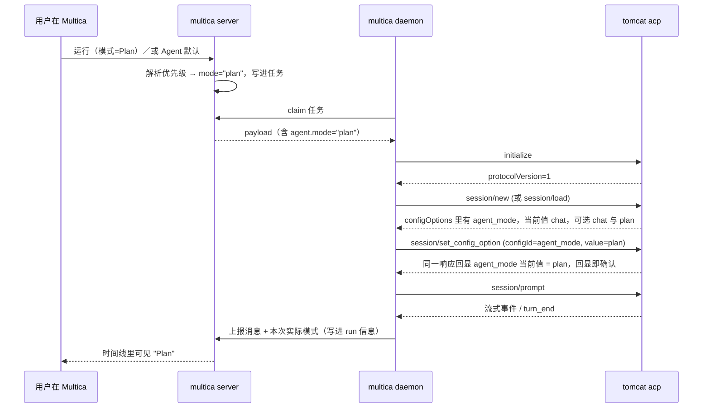
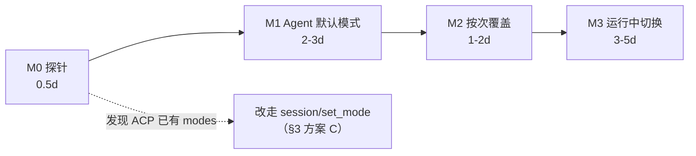

## 结论速览

**Tomcat 早就有"模式"，Multica 也有"下发通道"，缺的只是把线接上。**

- **Tomcat 侧现状**：每个会话有一个 `agent_mode ∈ {chat, plan}`，可以通过 `/plan` 命令或 serve 协议的 `set_plan_mode` 切换，并且随会话持久化（resume 会恢复）。
- **Multica 侧现状**：用 `tomcat acp` 启动 Tomcat，走的是 ACP 协议；ACP 通道当前只暴露了 `model` 一个可调项，**没有 mode**。
- 所以本方案不发明新的模式系统，只做两件事：**① 在 Tomcat 的 ACP 层把 `agent_mode` 暴露成一个 select 类型的配置项；② 在 Multica 侧把"模式"当成一次运行的执行参数，从 UI 一路下发到 ACP 并回读确认。**

推荐四步走，每步都能单独验收：

| 阶段 | 内容 | 目的 |
|---|---|---|
| M0 | 探针验证（独立终端抓一次真实 `session/new`） | 把"ACP 到底暴露了什么"钉死，消除唯一未知项 |
| M1 | Agent 级默认模式（最小闭环） | 让 `multica` 里跑的任务真的能进 Plan 模式 |
| M2 | 按次运行覆盖（下发前选 Chat/Plan） | 才是真正的"切换" |
| M3 | 运行中切换（下一轮生效） | 长任务的体验补齐 |

---

## 1. 背景与目标

**目标**：在 Multica 里，为一次 Tomcat 运行选择 **Chat** 或 **Plan** 模式，既能下发前选，也能对正在跑的任务切换。

**Chat 模式**：Tomcat 正常干活，可以改文件、跑命令。
**Plan 模式**：Tomcat 只出方案（写计划文件、不碰代码），确认后再执行 `/plan build`。

**非目标**（本方案不碰）：不改 Tomcat 的 plan 文件格式；不改 ACP 协议本身；不做多人共享模式的权限模型。

---

## 2. 现状：能力都在，通道没通

### 2.1 一张图看清问题

```
现状：能力存在，但通道没通

   Multica 网页 / CLI
        │  只能选 model、thinking level
        ▼
   multica daemon ──ACP(stdio)──▶ tomcat acp ──▶ 会话 (agent_mode = "chat")
        │                                            ▲
        │  ← 模式在这里没有入口                       │ 只有 /plan 命令
        │                                              │ 或 serve 协议能改
        └──────────────────────────────────────────────┘
                             （VS Code 扩展走的是 serve 协议，所以它能切）

目标：把线接上

   Multica 网页 / CLI
        │  选 Chat / Plan
        ▼
   multica daemon ──ACP──▶ tomcat acp ──set_config_option(agent_mode)──▶ 会话
        ▲                                                                   │
        └──────────── 同一响应里回显当前模式，用于确认 ◀───────────────────┘
```

**一句话根因**：Tomcat 有模式、也有 setter；Multica 只连了 ACP，而 ACP 这一层没把 mode 暴露出来。这件事的实质是"**把 Tomcat 已有的模式能力从 serve 协议搬到 ACP 协议，再由 Multica 的值驱动它**"。

### 2.2 证据清单（都可复核）

| 事实 | 证据 |
|---|---|
| Tomcat 会话有 `agent_mode`，取值就是 `chat` / `plan` | 扩展源码 `out/ui/webview/state.js:1541`（判断 `agentMode` 是 `chat` 还是 `plan`，二者之外一律不接受） |
| 模式变化会作为事件广播 `session.agent_mode.changed` | tomcat 二进制字符串表（事件名列表，与 `plan.enter` / `plan.exit` 同组） |
| Tomcat 有 `/plan` 命令族（enter / exit / build） | 二进制 i18n 键 `slash.plan.entered`、`slash.plan.exited`、`slash.plan.buildFailed`、`slash.plan.usage` |
| Tomcat serve 协议有 `set_plan_mode`，带 `action` + 可选 `planId` | 扩展源码 `out/serveClient/TomcatMessenger.js:364`；调用点 `out/ui/webview/provider.js:2417`（`sendSetPlanMode`） |
| 模式随会话持久化，resume 会带回来 | 二进制会话索引结构含 `agent_mode`、`active_plan_id` |
| Multica 以 `tomcat acp` 启动，握手只有 `initialize` → `session/new` 或 `session/load` → `session/prompt` | `server/pkg/agent/tomcat.go:197-253`；`tomcat acp --help` 只有 `--skills-dir` 一个参数 |
| ACP 通道能用的方法只有 new / load / prompt / cancel / set_config_option | 二进制方法白名单字符串 `session/new`、`session/load`、`session/prompt`、`session/cancel`、`session/set_config_option`、`unknown_config_option` |
| Multica 只解析 `model` 这一个配置项 | `server/pkg/agent/tomcat.go:261-276`（`tomcatCurrentModel` 只找 `id == "model"`） |
| Multica 完全没有 ACP 的 mode 能力 | 全仓（server/apps/packages/docs/e2e）grep `session/set_mode`、`availableModes`、`currentModeId`、`current_mode_update` 均无实现命中；`modes` 只出现在测试 fixture 和一条注释里 |
| Multica 的"确认"靠响应的回显，不靠通知 | `server/pkg/agent/tomcat.go:247`（用 `set_config_option` 的响应回读 model）；`server/pkg/agent/acp_effort.go:203-207` 明确写着 `config_option_update` 通知"从不使用：无法对应、可能晚于响应、可能描述的还是旧模型" |
| 执行参数的标准链路：agent 表列 → claim payload → ExecOptions | `server/migrations/095_agent_thinking_level.up.sql` → `server/internal/handler/agent.go:116-119` → `server/internal/handler/daemon.go:3008` → `server/internal/daemon/types.go:231` → `server/pkg/agent/agent.go:118` → `server/internal/daemon/daemon.go:8957` |
| Multica 有 server→daemon 的运行中 RPC 通道 | 运行时能力位 `rpc-v1`（`server/pkg/protocol/messages.go:29`），实现 `server/internal/daemon/wsrpc.go` |

### 2.3 一个必须提前说清的坑：Plan 的产物在哪

Plan 模式产出的计划文件落在 **daemon 所在机器的 `~/.tomcat/plans/`**，Multica 的用户看不到它。所以 Plan 模式在 Multica 里必须**把方案作为评论回到 issue**，否则用户看到的是"任务跑完了但什么都没发生"。这一点决定了 M1 的验收标准（见 §6）。

---

## 3. 方案取舍

三条路，都能做到"切换"，差别在成本和长期形态：

| | A. 提示词前缀 `/plan` | **B. ACP 配置项 `agent_mode`（推荐）** | C. ACP 会话模式 `session/set_mode` |
|---|---|---|---|
| Tomcat 改动 | 0（依赖 ACP 会解析用户输入的斜杠命令，**未验证**） | 中：`session/new`、`session/load` 多广告一个 select，`set_config_option` 多接受一个 id | 中：`session/new`、`session/load` 填 `modes`，新增 `session/set_mode` 处理 |
| Multica 改动 | 小：prompt 拼前缀 | 小：仿 `model` 的解析+应用各加一段 | 中：新增模式解析 + 新 RPC + 新通知类型处理 |
| 切换确认 | 无（不知道到底进没进 Plan） | **有**，同一次响应里回显 | 弱：只能靠 `current_mode_update` 通知 |
| 对第三方 ACP 客户端 | 无 | 无 | **有**（Zed 等可直接显示模式） |
| 失败可见性 | 差（模型可能把 `/plan` 当普通文本） | 好（未知 id 会明确报 `unknown_config_option`） | 中 |
| 污染对话记录 | **会**（模式切换变成一条用户消息） | 不会 | 不会 |

**决策：V1 用 B。** 决定性理由不是"B 更优雅"，而是 **Multica 的 ACP 客户端根本不消费 `config_option_update` 通知**：

- `server/pkg/agent/tomcat.go:88` —— `acceptNotification` 只在开始流式输出之后才接受通知；
- `server/pkg/agent/acp_effort.go:203-207` —— 注释明确说这类通知"无法对应、可能晚于响应、可能描述的还是旧模型"，因此整个模型/推理强度体系都用"请求-响应回显"确认。

选 C 会一头撞进这个已经踩过坑的设计里：`session/set_mode` 的语义是"发一个请求，模式变化靠通知告诉你"，而 Multica 会在 `session/prompt` 之前把这条通知直接丢掉，于是"切了但不知道切没切"。

**C 记录为长期形态**：一旦 Multica 的客户端想吃 ACP 模式（或要支持 Zed 这类第三方客户端），Tomcat 可以同时广告 `modes` 与配置项，Multica 再按能力协商优先用 `set_mode`。**但现在不要同时做两条通道。**

**A 只作为 M0 的免费验证**：如果 `/plan` 前缀在 ACP 下确实生效，M1 之前就能先跑通一次端到端体验；但它不能作为产品方案（污染对话、无确认、不可回读）。

---

## 4. 推荐设计

### 4.1 模式是什么：一次运行的执行参数，不是 Issue 的属性

优先级（高 → 低），只有拿到非空值才下发，**不覆盖用户没选的情况**：

```
   ① 本次运行指定（M2，任务级）        ← 本次就是要在 Plan 里试试
        │ 没有
        ▼
   ② Agent 默认（M1，agent.mode）       ← 这个 agent 平时怎么干活
        │ 没有
        ▼
   ③ 不下发，继承 Tomcat 会话里的值     ← 尊重 VS Code 里手工设过的模式
```

为什么不做成 Issue 属性：**模式是"一次运行"的属性，不是"一个 issue"的属性**。同一个 issue 先 Plan 出方案、再 Chat 实施，是正常流程；把模式钉在 issue 上会让第二次运行带着上次的模式跑。同理也**不建议**用工作区自定义属性做控制流——属性名可被改名、可本地化，控制流不该依赖用户可编辑的字符串。

### 4.2 端到端时序（以 M2 完成为例）



### 4.3 ACP 契约：Tomcat 侧要加什么（唯一的跨仓库接口）

在 `session/new` 与 `session/load` 的结果 `configOptions` 里，增加一个 select 项（字段名与现有 `model` 选项一致）：

```json
{
  "id": "agent_mode",
  "name": "Mode",
  "category": "mode",
  "type": "select",
  "currentValue": "chat",
  "options": [
    { "value": "chat", "name": "Chat", "description": "直接执行任务" },
    { "value": "plan", "name": "Plan", "description": "只出方案，不改代码" }
  ]
}
```

配套要求：

1. `session/set_config_option{configId:"agent_mode", value:"chat"|"plan"}` 必须接受，并在**同一个响应里回显新的 `currentValue`**（这是 Multica 判定成功的唯一依据）。
2. 内部状态必须与 `/plan enter`、`/plan exit`、`set_plan_mode` 共用同一份 `agent_mode`——**单一事实来源**，否则用户在 VS Code 里切了、在 Multica 里看到的还是旧值。
3. `/plan build` 不是模式，不要放进 select（它是"拿着已有方案开工"的动作）。
4. 非法值返回明确的错误（沿用现有 `unknown_config_option` 语义）。
5. 兼容性：老版本 Tomcat 不广告该选项 → Multica 不发请求、UI 显示"当前 runtime 不支持"，不报错。

### 4.4 Multica 侧改动清单（按文件，可直接排期）

| 层 | 文件 | 改动 |
|---|---|---|
| DB | 新增 `server/migrations/096_agent_mode.up.sql` | `ALTER TABLE agent ADD COLUMN mode TEXT`，校验 `IN ('chat','plan')`（照抄 `095_agent_thinking_level.up.sql` 的形态） |
| API 类型 | `server/internal/handler/agent.go:116-119` | 增加 `Mode` 字段（json 名为 `mode`），创建/更新时校验取值 |
| Claim 打包 | `server/internal/handler/daemon.go:3008` | `TaskAgentData` 增加 `Mode`（与 `ThinkingLevel` 同一处） |
| Daemon 类型 | `server/internal/daemon/types.go:231` | 镜像字段 |
| Daemon 执行 | `server/internal/daemon/daemon.go:8957` | `ExecOptions.Mode: mode`（与 `ThinkingLevel: thinkingLevel` 同一行组） |
| SDK | `server/pkg/agent/agent.go:118` 附近 | `ExecOptions.Mode string` |
| ACP | 新增 `server/pkg/agent/acp_mode.go` | `parseACPModeOption` / `applyACPModeOption`，直接照 `server/pkg/agent/acp_effort.go:85` 与 `:295` 的写法（解析 → 校验 → 发 `set_config_option` → 读回 → 记日志） |
| ACP | `server/pkg/agent/tomcat.go:238-249` | 在 model 之后、`session/prompt` 之前应用 mode；`session/new` 与 `session/load` 都要走（否则 resume 会继承旧模式） |
| 任务级覆盖（M2） | `server/internal/service/task.go:1285`、`server/pkg/db/queries/agent.sql:339` | 任务行增加 `mode` 列并在 enqueue 时写入；claim 时优先于 agent 默认 |
| UI（M1） | `packages/views/agents/components/agent-detail-inspector.tsx:284-359` | "执行"区新增 `ModePicker`，紧跟 `ThinkingSettingField`（:322） |
| UI 组件（M1） | 新增 `packages/views/agents/components/inspector/mode-picker.tsx` | 复用 `PropertyPicker` / `PickerItem`，chip 与 field 两种形态（参照 `service-tier-setting-field.tsx:68-178`） |
| 持久化（M1） | `packages/views/agents/components/agent-detail-page.tsx:217-287` | 沿用现有乐观更新 + `api.updateAgent` + 失效查询的写法 |
| i18n | `packages/views/locales/{en,zh-Hans,zh-Hant,ja,ko,fr}/` | 6 个语言都要加 key（有对齐测试 `packages/views/agents/agents-i18n-parity.test.ts`） |

### 4.5 失败策略：宁可不跑，也不静默降级

| 情况 | 行为 |
|---|---|
| 用户**显式**选了 Plan，但 Tomcat 不接受（老版本 / 报错） | **让这次运行失败**，错误写进 run 记录并提示"当前 runtime 的 Tomcat 不支持模式切换，请升级"。绝不静默降级成 Chat——Plan 模式的意义就是"不要改代码"，静默降级会直接改坏仓库。 |
| 没有选择（值为空） | 不发 `set_config_option`，沿用会话里的模式。 |
| 选了 Plan 且成功 | run 记录里回写实际生效值（回显值），UI 可见。 |

### 4.6 运行中切换（M3）只能是"下一轮生效"

客户端侧已有先例：VS Code 扩展在发 `set_plan_mode` 之前会先检查会话是否 busy、队列里还有没有消息，忙就直接忽略这次切换（`out/ui/webview/provider.js:2411`）。所以"运行中切换"的产品语义应当是：**当前这一轮不受影响，下一轮生效**。

实现路径：Multica 已有 server→daemon 的 RPC 通道（能力位 `rpc-v1`，`server/pkg/protocol/messages.go:29`，实现 `server/internal/daemon/wsrpc.go`）。daemon 收到"把 task 切到 plan"的 RPC 后，在**轮次边界**对活着的 ACP 连接发 `session/set_config_option`，成功后回推任务状态，UI 立刻显示"将在下一轮生效"。

兜底方案（不推荐，仅当 RPC 排期不上）：用现有的 steer 通道，把"下一轮请进入 plan 模式"当作自然语言指令注入。缺点是它变成对话内容、不是协议状态，UI 也无法准确显示当前模式。

### 4.7 Plan 运行的收尾语义（产品决策，建议值）

Plan 模式的运行结束后，**issue 状态建议停在 `in_review`**：方案已经产出、等待人确认，而不是自动进入 `in_progress` 继续实现。用户确认后，再发一条"按方案实施"的指令（或 `/plan build`）进入 Chat 模式的运行。

---

## 5. 为什么这样切分阶段



| 阶段 | 改动面 | 验收标准 | 回滚 |
|---|---|---|---|
| **M0** | 0 行代码，只跑探针 | 抓到一次真实 `session/new`，确认 `configOptions` 里没有 mode（也没有 `modes`） | 无需回滚 |
| **M1** | Tomcat ACP 一处 + Multica 7 处 + 1 个 migration | 把 agent 设成 Plan，跑一条任务：**日志里能看到 `agent_mode` 回显为 `plan`，且该运行没有改任何文件，方案以评论形式回到 issue** | 去掉 `agent.mode` 即回退（列可空） |
| **M2** | 任务表加一列 + 下发入口 | 同一个 agent，两条任务一条 Chat 一条 Plan，各自行为正确 | 覆盖值为空即回到 M1 行为 |
| **M3** | 新增 RPC + 运行视图控件 | 运行中切到 Plan，当前轮不受影响，下一轮进入 Plan，UI 显示一致 | 关闭入口 |

---

## 6. 测试策略

**Tomcat 侧（契约）**
- `session/new` 与 `session/load` 都返回 `agent_mode` 选项，`currentValue` 反映真实状态。
- `set_config_option` 成功后响应里的 `currentValue` 就是新值。
- 非法值报错；`/plan enter` 与 ACP 设置互相可见（单一事实来源）。

**Multica 侧（按现有测试形态就近加）**
- `server/pkg/agent/tomcat_test.go:74` 已经有一个 fake ACP 脚本在 `session/set_config_option` 分支上做模型断言 —— 直接扩一个 `configId == "agent_mode"` 分支即可，这是最省力的回归位。
- `server/pkg/agent/acp_effort_test.go` 的写法可以整体照搬给 `acp_mode_test.go`（含"选项不存在时不发请求"的用例）。
- 新字段透传：claim payload 单测 + `internal/daemon` 的 `ExecOptions` 构造单测。
- 目标命令：`go test ./pkg/agent ./internal/daemon ./internal/handler -run 'Tomcat|Mode|Claim'`。

**UI**
- 6 个 locale 对齐（`agents-i18n-parity.test.ts`）。
- 手工验收：模型选择器旁出现"模式"，切换即时保存，刷新后仍为所选值。

---

## 7. 风险与未决问题

| 风险 / 未决 | 说明与建议 |
|---|---|
| **UNVERIFIED**：Tomcat 的 ACP `session/new` 是否已经带了 `modes` | 我用探针脚本连 `tomcat acp` 时被 Tomcat 自己的守卫挡住了（`TOMCAT_AGENT_ACTIVE`：拒绝在活动会话内运行会改动会话状态的命令）。**必须在独立终端验证**，脚本见 §8。结论若为"已有 modes"，则 §3 的决策需要复议 |
| 老版本 Tomcat 无该选项 | 按 §4.3 第 5 条做能力协商，UI 置灰并提示升级，不报错 |
| resume 继承旧模式导致"意外在 Plan 里" | `session/load` 也要应用模式；UI 上把"当前生效模式"显式展示出来，不要靠推断 |
| Plan 产物在 daemon 主机，用户看不到 | M1 必须同时落"方案以评论回传"的要求（写进运行时 brief 或 prompt），否则功能不可用 |
| 并发：同一 issue 多个 run 各自模式 | 模式挂在任务上而不是 issue 上，天然隔离；M2 已覆盖 |
| Plan 模式的 token / 时长成本 | Plan 轮次通常更短，但会多一个"确认-再执行"的往返；建议在 run 视图里按模式区分展示 |
| 是否要让 Chat/Plan 也影响 Multica 自己的状态流转 | 见 §4.7，建议先只做 `in_review`，不改工作流定义 |

---

## 8. 附录：M0 探针（在独立终端跑）

```bash
# 必须在一个"非 Tomcat 会话"的终端里跑（TOMCAT_AGENT_ACTIVE 未设置）
python3 - <<'PY'
import json, subprocess
BIN = "/path/to/tomcat"
p = subprocess.Popen([BIN, "acp"], stdin=subprocess.PIPE, stdout=subprocess.PIPE, text=True, bufsize=1, cwd="/tmp")
def send(o): p.stdin.write(json.dumps(o)+"\n"); p.stdin.flush()
send({"jsonrpc":"2.0","id":1,"method":"initialize","params":{"protocolVersion":1,
      "clientInfo":{"name":"probe","version":"0"},"clientCapabilities":{}}})
print(p.stdout.readline())                      # initialize 结果
send({"jsonrpc":"2.0","id":2,"method":"session/new","params":{"cwd":"/tmp","mcpServers":[]}})
print(p.stdout.readline())                      # ← 看 configOptions 与 modes
p.stdin.close()
PY
```

判定：`session/new` 结果里出现 `configOptions[].id == "agent_mode"` → 本方案 M1 可以直接对接；只出现 `modes` → 走 §3 的方案 C；两者都没有 → 按 §4.3 先改 Tomcat。