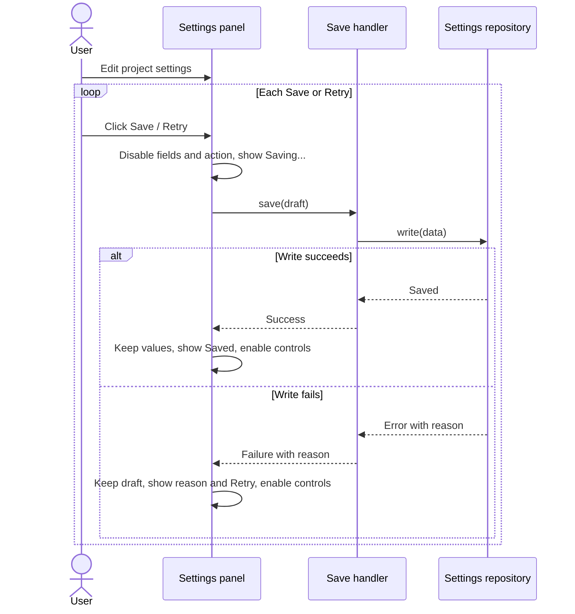

# Plan Writing Standards

Technical design, prose, and visual guidelines for development plans.

## Technical Design and explanation standards

- Reason from first principles: when planning or coding, work out the architecture and implementation from first principles, follow best practices, pursue the most elegant solution, and dare to overturn a flawed technical design rather than patch around it.
- Keep the design elegant while strictly avoiding over-design.
- Put user experience first: when a task involves UI, design it from the user's experience and above all follow the existing UI design conventions of the user's project.

## Writing Requirements

### Prose Rules

- 总纲：简明扼要、言简意赅、说人话，不要写又臭又长的计划。

- 结合图示与文字，以图（ASCII 图或 Mermaid 流程图）为主、文字为辅；一图胜千言，所有文字输出都必须简明扼要、言简意赅。

### Diagram Rules

- Typically, use ASCII for architecture, and Mermaid for flows and sequence diagrams.
- Add a diagram inside each complex section: trace relevant success/failure branches. For UI, show layout, controls, and feedback, not a list of text labels.
- Draw the relevant actions and paths, not just boxes of component names: label arrows with verbs such as "read draft", "save settings", and "notify UI". Make added, removed, or changed paths visible; keep names and directions consistent in comparisons. An overall takeaway may connect several components or changes.

### Diagram Examples

The same feature—saving project settings—shown as architecture, interaction, and UI.

#### Architecture: responsibilities and boundaries

```text
+----------------------------+
| UI: Settings panel         |
| Owns draft + save feedback |
+------------+-------^-------+
             |       |
 save(draft) |       | saved / error
             v       |
+------------+-------+-------+
| Application: Save handler  |
| Calls repository; replies  |
+------------+-------^-------+
             |       |
 write(data) |       | success / failure
             v       |
+------------+-------+-------+
| Persistence: Repository    |
| Reads/writes settings file |
+----------------------------+
```

The panel owns unsaved input; only the repository writes persisted settings.

#### Sequence: saving, failure, and retry



Retry uses the current draft through the same save path; failure does not reset the form.

#### UI: layout, controls, and feedback

```text
+-- Project settings -------------------------------------------+
|                                                               |
| Project name                                                  |
| +-----------------------------------------------------------+ |
| | Atlas                                                     | |
| +-----------------------------------------------------------+ |
|                                                               |
| [x] Enable automatic saving                                   |
|                                                               |
| ! Settings could not be saved.                                |
|   Permission denied. Check folder access, then retry.         |
|                                                               |
| Changes not saved.                                [ Retry ]   |
+---------------------------------------------------------------+
```

Shown after failure: input is retained and editable, with the reason next to the retry action. The primary action is `Save` normally, disabled `Saving...` during a request, and `Retry` after failure; success shows `Saved` and restores `Save`.
